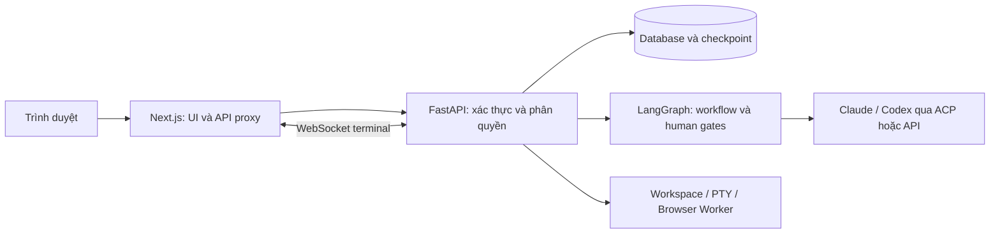

# 1devTeams — Đội ngũ AI cho quy trình phát triển phần mềm

Quản lý AI agents, tổ chức teams và điều phối công việc từ yêu cầu đến kiểm thử,
phê duyệt và Git release trên một giao diện web. Chat trực tiếp với agent hoặc
làm việc theo ticket, theo dõi tool, diff, log và terminal ngay trong workspace.

**FastAPI · Next.js · LangGraph · Claude Code · Codex · ACP/API**

## ⚡ Bắt đầu nhanh

### 1. Cài bằng một lệnh

Không cần clone repository, giải nén source hoặc cài sẵn Python/Node.js/Git.
Bootstrap tải source và gọi bộ cài tương ứng với hệ điều hành.

Windows — PowerShell:

```powershell
irm https://raw.githubusercontent.com/jokerhung/1devteams/main/install.ps1 | iex
```

Linux / macOS — Terminal:

```bash
curl -fsSL https://raw.githubusercontent.com/jokerhung/1devteams/main/install.sh | bash
```

> Các URL chỉ dùng được sau khi toàn bộ bộ cài được push lên nhánh `main` của
> repository công khai. Đọc script trước khi thực thi. Linux cần `curl`, `tar`,
> `bash` và quyền `sudo`; Windows/macOS có thể yêu cầu xác nhận cài công cụ hệ thống.

Thư mục mặc định: `%LOCALAPPDATA%\1devTeams` trên Windows, `$HOME/1devTeams`
trên Linux/macOS. Có thể chọn đường dẫn tuyệt đối khác bằng biến
`ONEDEVTEAMS_INSTALL_DIR`. Chạy lại cùng lệnh trên máy đã cài sẽ **cập nhật
source mới nhất từ nhánh `main`, đồng bộ dependency, build và khởi động lại server**,
rồi in URL localhost/IP khi web sẵn sàng. Các file `.env`, cấu hình trong
`backend/config`, workspace và dữ liệu được giữ nguyên. Trước khi cập nhật,
script dừng tiến trình của đúng bản cài và sao lưu SQLite, dữ liệu, cấu hình cùng
source bị thay thế vào `backups/update-…`. Migration cần thiết vẫn chạy khi
ứng dụng khởi động, không reset tài khoản hay dữ liệu người dùng.
Nếu tải source thất bại, server đang chạy không bị dừng. Cài dở thiếu venv hoặc
cấu hình sẽ được tiếp tục cài tự động. Nếu mất `backend/.env` nhưng còn dữ liệu
cũ, cần khôi phục file cấu hình gốc để giữ secret mã hóa. Luồng tự cập nhật hiện hỗ trợ SQLite;
PostgreSQL cần sao lưu và nâng cấp thủ công.

Bộ cài tạo virtual environment riêng tại `backend/.venv` bằng uv, cài dependency
backend vào venv (không cài Python package toàn hệ thống), build frontend,
sinh secret ngẫu nhiên, migrate database và tạo sẵn:

| Thành phần | Dữ liệu ban đầu |
| --- | --- |
| Owner | Email `owner@example.com`, mật khẩu mặc định `123456` |
| 9 agents | `@ba`, `@developer`, `@tester`, `@devops`, `@leader`, `@planner`, `@designer`, `@workflow`, `@security` |
| 3 teams | Core Bugfix Squad, Feature Delivery Squad, Security Review Squad |
| 4 templates | Blank, Fix Bug, Add Feature, Fix Bug + Security Review |

### 2. Truy cập web sau khi cài

Cài thành công sẽ **tự khởi động backend và frontend**. Khi cả hai dịch vụ sẵn
sàng, terminal in các URL truy cập, ví dụ (IP phụ thuộc máy):

```text
1devTeams is ready.
  Localhost: http://localhost:3060
  Network:   http://192.168.1.20:3060
```

Giữ terminal mở trong khi sử dụng; Ctrl+C dừng cả hai dịch vụ. Link IP dùng
được khi thiết bị truy cập có kết nối LAN/VPN tới máy chủ và firewall cho phép
cổng web. Nếu không phát hiện IP phù hợp, launcher vẫn in link localhost và
báo rõ trạng thái mạng. Không tự mở firewall hoặc tạo public URL.

Để khởi động lại sau khi đã dừng, dùng các lệnh dưới đây.

Windows:

```powershell
cd "$env:LOCALAPPDATA\1devTeams"
.\backend\.venv\Scripts\python.exe scripts/install/run.py
```

Linux/macOS:

```bash
cd "$HOME/1devTeams"
./backend/.venv/bin/python scripts/install/run.py
```

Nếu chọn thư mục riêng, `cd` tới thư mục đó. Mở **http://localhost:3060** và đăng
nhập bằng `BOOTSTRAP_ADMIN_EMAIL` / `BOOTSTRAP_ADMIN_PASSWORD` trong `backend/.env`.
Không chia sẻ file này. Ctrl+C dừng cả hai dịch vụ; `--check` kiểm tra khởi động
rồi dừng, `--no-open` không tự mở browser.

**Đổi mật khẩu `123456` ngay sau đăng nhập và trước khi mở truy cập qua mạng.**
Đây là mật khẩu khởi tạo công khai, chỉ áp dụng khi cài mới; chạy lại bộ cài
không đổi mật khẩu của tài khoản đã tồn tại. Mật khẩu mới phải có ít nhất 8 ký tự.

### 3. Kết nối AI và tạo project

1. Vào **Settings → Adapters → Login** để đăng nhập Claude/Codex.
2. Bộ cài mới bật sẵn native agents và terminal. Với cấu hình cũ đang tắt, đặt
   `TRUSTED_NATIVE_ACP=true`, `ENABLE_REMOTE_TERMINAL=true` trong `backend/.env`
   rồi khởi động lại server.
3. Chọn thư mục được phép truy cập trong **Settings → Workspaces**, tạo project,
   chọn team/template và bắt đầu ticket; hoặc chat trực tiếp với từng agent.

Bộ cài không cung cấp tài khoản hay gói dịch vụ AI. Xem
[hướng dẫn cài đặt](scripts/install/README.md) để đổi email Owner, cổng, workspace,
cấu hình LAN, cài từ source hoặc chạy lại an toàn.

## 📱 Nền tảng hỗ trợ

| Nền tảng | Máy chạy dịch vụ | Cách truy cập |
| --- | --- | --- |
| Windows 10/11 | Bộ cài PowerShell 5.1+ | Trình duyệt web |
| Linux | Bộ cài Ubuntu 22.04/24.04, Debian 12/13; x64/ARM64 | Trình duyệt web |
| macOS | Bộ cài Intel/Apple Silicon; cần phiên bản tương thích Playwright | Trình duyệt web |
| Máy tính khác trong mạng | Không cần cài backend tại máy khách | URL máy chủ, với mạng/CORS được cấu hình |
| iOS / Android | Không có bộ cài host hoặc ứng dụng native trong repo | Truy cập web; trải nghiệm di động chưa được xác minh đầy đủ |

Hiện phân phối bằng source và script; chưa có gói desktop EXE/DMG/AppImage.
Đã kiểm tra cú pháp script, bootstrap Windows bằng tải giả lập và khởi tạo dữ liệu
trên SQLite tạm. Chưa xác minh cài end-to-end trên máy sạch cho từng OS, đặc biệt
Linux/macOS; không xem bảng trên là chứng nhận tương thích mọi cấu hình.

## ✨ 8 tính năng nổi bật

1. **Agents & Teams:** cấu hình vai trò, prompt, runtime, model và quyền; tổ chức
   agent thành đội phục vụ từng quy trình.
2. **Chat trực tiếp với agent:** không bắt buộc tạo ticket; chọn project hoặc
   để trống, tự lấy project theo trang đang mở khi phù hợp.
3. **Workflow trực quan:** dựng luồng bằng canvas, dùng template, kiểm tra tính
   hợp lệ và quản lý phiên bản trước khi chạy. Hoặc dùng **Orchestrator** để
   chọn agent điều phối và nhập instruction, không cần vẽ luồng.
4. **Ticket theo quy trình:** chuyển việc giữa BA, Developer, Tester và DevOps;
   hỗ trợ hỏi lại người dùng và bước phê duyệt trước Git release.
5. **Theo dõi lượt chạy:** hiển thị trạng thái đang làm việc, các action gần nhất
   và chi tiết tool, diff, log, terminal để kiểm tra kết quả thực tế.
6. **Workspace và ảnh đính kèm:** duyệt file trong thư mục được phép, xem ảnh
   phóng to trong popup và tải ảnh từ cuộc trò chuyện.
7. **Terminal thời gian thực:** WebSocket hai chiều, gom output theo frame,
   WebGL với fallback và lấy bù output khi kết nối lại. Trong project và trang
   con, terminal dùng workspace của project; ngoài project, Owner/Admin tự mở
   terminal tại thư mục đầu tiên trong danh sách cho phép, không cần chọn project.
8. **Browser Worker & thông báo:** agent có quyền browser có thể thao tác qua
   Playwright; thông báo trong ứng dụng, toast và browser notification khi
   trình duyệt hỗ trợ và người dùng đã cấp quyền.

### Orchestrator trong project

1. Thêm AI Team/agents vào project; cần một agent điều phối và ít nhất một agent thực hiện.
2. Chọn **Tạo Orchestrator**, chọn agent điều phối và nhập instruction, ví dụ:
   “BA phân tích → Planner lập kế hoạch → Developer triển khai → Tester kiểm thử;
   nếu FAIL giao Developer sửa rồi kiểm thử lại; nếu PASS tổng kết bàn giao.”
3. Bấm **Lưu & xuất bản**, tạo ticket và bắt đầu chạy. Agent điều phối tự chọn
   thành viên tiếp theo từ các agents đang hoạt động trong project.

Các agent dùng runtime/model/tools và quyền đã cấu hình. Kết quả từng lượt được
lưu vào lịch sử/checkpoint và chia sẻ cho các lượt sau. Mặc định sau 20 lượt điều
phối, hệ thống hỏi người dùng trước khi tiếp tục (cấu hình từ 1–40 lượt).
Khi chọn FINISH, Orchestrator tổng kết và hoàn tất ticket. Commit/push vẫn dùng
thao tác phát hành có xác nhận hiện có. Chỉnh instruction/agent điều phối tạo
phiên bản mới; ticket cũ giữ nguyên phiên bản đã lưu.

## 🛡️ Kiến trúc và bảo mật

Ứng dụng tự host trên máy của bạn. Trình duyệt truy cập Next.js; backend FastAPI
quản lý dữ liệu, workflow, kết nối AI và các công cụ trên máy chủ.



- **Tài khoản và quyền:** xác thực JWT, cookie HttpOnly phía web và phân quyền
  theo tài khoản/project. Terminal kiểm tra Origin và quyền ghi project.
- **Secret:** mật khẩu được hash; credential AI lưu mã hóa bằng Fernet với
  `APP_SECRET_KEY`. Bộ cài sinh khóa riêng, không dùng secret mặc định chung.
- **Workspace:** cấu hình các thư mục ứng dụng được phép truy cập bằng
  `ALLOWED_WORKSPACE_ROOTS` hoặc Settings. Đây không phải sandbox cho mọi công
  cụ mà native agent có thể gọi.
- **Quyền tools:** Bộ cài mới bật `TRUSTED_NATIVE_ACP` và `ENABLE_REMOTE_TERMINAL`.
  Cấu hình cũ được giữ nguyên. Native tools/terminal có quyền của OS user chạy dịch vụ;
  permission profile trong UI không thay thế cách ly hệ điều hành.
- **Kiểm soát của con người:** các template có bước Git release yêu cầu xác nhận
  trước khi phát hành. Theo dõi log/diff và kiểm tra thay đổi trước khi duyệt.

Không có cơ chế pairing, tunnel mã hóa đầu-cuối hay remote desktop WebRTC trong
triển khai này. Nội dung gửi cho nhà cung cấp AI vẫn rời máy chủ theo cấu hình
provider. Không đưa secret, file `.env` hoặc log chứa credential lên issue công khai.

## 📂 Cấu trúc monorepo

```text
backend/
  app/                 FastAPI, ACP/API, workflow engine và services
  alembic/             Database migrations
  scripts/             Công cụ kiểm tra ACP
  tests/               Kiểm thử backend
frontend/
  src/                 Next.js UI, workflow canvas, chat và terminal
  tests/               Kiểm thử frontend
scripts/
  install/             Bộ cài 3 OS, seed dữ liệu, launcher và kiểm thử
  dev.ps1              Launcher phát triển trên Windows
docs/
  specs/               Thiết kế, ghi chú triển khai và kết quả kiểm chứng
install.ps1            Bootstrap một lệnh cho Windows
install.sh             Bootstrap một lệnh cho Linux/macOS
```

Backend dùng Python, FastAPI, SQLAlchemy/Alembic và LangGraph; frontend dùng
Next.js 15, React 19, TypeScript, React Flow và xterm.js. Chromium/Playwright
phục vụ Browser Worker. ACP adapters được pin tại `package-lock.json` gốc.

## 🌐 Self-hosting

### Cấu hình và dữ liệu

| Vị trí | Vai trò |
| --- | --- |
| `.env` | `FRONTEND_PORT=3060`, `BACKEND_PORT=8060` |
| `backend/.env` | Secret, Owner bootstrap, database, workspace, CORS và quyền native/terminal |
| `frontend/.env` | `BACKEND_URL`, `NEXT_PUBLIC_API_URL` |
| `backend/data/` | Database SQLite và checkpoint mặc định của bộ cài, dữ liệu ứng dụng |
| `.tools/` | Runtime/dependency cục bộ và thông tin khởi chạy |
| `.dev-logs/` | Log launcher; không commit |

`ALLOWED_WORKSPACE_ROOTS` phân cách bằng `;`, `CORS_ORIGINS` bằng `,`.
Backend hỗ trợ cấu hình database khác; bộ cài mới mặc định dùng SQLite.
Sao lưu database, dữ liệu và `.env` trước khi nâng cấp; mất `APP_SECRET_KEY`
có thể khiến credential đã mã hóa không đọc được.

### Truy cập từ LAN hoặc domain

Launcher production mở frontend trên `0.0.0.0`, backend trên `127.0.0.1`.
Browser gọi `/api/backend` cùng origin; Next.js proxy tới `BACKEND_URL`.

1. Cấu hình firewall/mạng chỉ cho những máy được phép truy cập.
2. Launcher tự thêm localhost và các IP mạng cục bộ phát hiện được vào CORS
   trong phiên chạy, giữ nguyên `.env` và các origin đã cấu hình. Với domain
   riêng, thêm origin vào `CORS_ORIGINS`; `-PublicUrl` / `--public-url` hỗ trợ
   việc này khi tạo cấu hình lần đầu.
3. Với truy cập từ xa, đặt HTTPS/reverse proxy phía trước web và cho phép
   WebSocket Upgrade tại `/ws/terminal/{project_id}`.

Không tự tạo DNS, TLS, tunnel hoặc mở firewall. Launcher chưa đăng ký Windows
Service/systemd/launchd; việc chạy nền và tự khởi động cần được cấu hình riêng.

### Terminal và reconnect

Client dùng `session_id` và `after_seq` để lấy bù output còn trong bộ đệm khi
mất kết nối. Backend giữ tối đa 262144 ký tự và 4096 chunk; nếu lịch sử cần lấy
đã hết hạn, client reset và phát lại phần còn giữ. WebGL tự chuyển về renderer
mặc định nếu không khả dụng.

**PTY vẫn nằm trong tiến trình backend:** shell có thể tồn tại qua mất kết nối
web đến thời hạn idle, nhưng restart backend sẽ kết thúc shell. Chưa có PTY
daemon độc lập giữ shell qua restart.

### Chạy lại bộ cài

Chạy lại lệnh một dòng `curl … | bash` / `irm … | iex` để cập nhật và khởi động
lại bản đã cài. Giữ terminal mở; Ctrl+C để dừng. Script chỉ dừng tiến trình
nhận diện được của bản cài đó, không kill ứng dụng khác chỉ vì chiếm cùng cổng.
Nếu cài dependency/build lỗi, server được giữ ở trạng thái dừng; sửa lỗi rồi
chạy lại lệnh. Đường dẫn bản sao lưu phục hồi được in ra màn hình.

Muốn cài lại dependency/build hoặc hoàn tất lần cài dở: dừng ứng dụng rồi
chạy script OS trong `scripts/install/` từ source đã có.
Cấu hình cũ và dữ liệu mẫu đã chỉnh được giữ lại; bộ cài không reset Owner.
Mặc định cài xong sẽ khởi động web; dùng `-NoStart` (Windows) hoặc `--no-start`
(Linux/macOS) nếu chỉ muốn cài/build mà không chạy dịch vụ.
Khi đổi cổng, cập nhật `.env`, URL frontend và CORS, rồi build lại để rewrite
WebSocket dùng đúng backend. Xem [hướng dẫn chi tiết](scripts/install/README.md).

## ✍️ Phân phối và ký phát hành

- Bootstrap hiện tải source nhánh `main` từ `jokerhung/1devteams`; chưa pin theo
  release tag hoặc commit bất biến.
- Chưa có binary desktop hoặc quy trình ký Authenticode/notarization trong
  bộ cài này. Không coi script là một bản phát hành đã được ký.
- Node tải cục bộ được đối chiếu SHA-256 với manifest của Node.js; kiểm tra này
  không thay thế xác minh nguồn script/source của 1devTeams.
- Chỉ chạy mã từ nguồn đã kiểm tra. Môi trường cần kiểm soát phiên bản chặt
  nên dùng checkout commit đã review và chạy bộ cài từ source đó.

## 🧪 Phát triển, kiểm thử và tài liệu

### Chạy môi trường phát triển

Sau khi đã cài dependency và cấu hình, tại thư mục gốc trên Windows:

```powershell
.\scripts\dev.ps1
# Đồng bộ dependency trước khi chạy:
.\scripts\dev.ps1 -Setup
# Kiểm tra startup rồi tự dừng:
.\scripts\dev.ps1 -SmokeTest
```

Launcher dùng Python trong `backend/.venv`, không cần activate thủ công.
Không dùng Uvicorn `--reload` trên Windows để giữ event loop phù hợp subprocess ACP.
Health tại `http://localhost:8060/api/health`, Swagger tại `http://localhost:8060/docs`.
Health xác nhận binary adapter tồn tại, không chứng minh login/inference thành công.
Adapter resolver ưu tiên `node_modules/.bin`, sau đó PATH; có thể override bằng
`CLAUDE_ACP_BIN` / `CODEX_ACP_BIN`.

### Kiểm tra tự động

```powershell
cd backend
uv run ruff check .
uv run ruff format --check .
uv run mypy
uv run pytest
cd ../frontend
npm run lint
npm run typecheck
npm run test
npm run build
npx playwright install chromium
npm run test:e2e
```

Kiểm tra bộ cài từ thư mục gốc (Windows; Unix dùng `backend/.venv/bin/python`):

```powershell
.\backend\.venv\Scripts\python.exe -m pytest scripts/install/tests -q
.\backend\.venv\Scripts\python.exe -m ruff check --config backend/pyproject.toml scripts/install
```

### Kiểm chứng ACP thật

Kiểm tra login bằng `claude auth status` / `codex login status` với CLI đã cài.
Từ `backend/`, chạy harness trong workspace tạm, không phải repo đang phát triển:

```powershell
uv run python scripts/acp_spike.py --runtime claude
uv run python scripts/acp_spike.py --runtime codex --mode read-only
```

Log `.ndjson`, `.client.ndjson`, `.stderr.log`, `.summary.json` được lưu trong
`backend/spike_logs/` (gitignored). Harness không phải sandbox; cần xem các
`checks`/`passed` và phạm vi chế độ chạy trước khi kết luận. Khử thông tin nhạy
cảm và kiểm tra thủ công trước khi chia sẻ log. Xem [ACP spike notes](docs/specs/ACP_SPIKE_NOTES.md).

### Tài liệu triển khai

- [Cài đặt, tùy chọn và khắc phục lỗi](scripts/install/README.md)
- [Browser Worker](docs/BROWSER_WORKER.md)
- [Phase 1 — ACP/API bridge](docs/specs/PHASE_1_IMPLEMENTATION_NOTES.md)
- [Phase 2 — Database & REST API](docs/specs/PHASE_2_IMPLEMENTATION_NOTES.md)
- [Phase 3 — Workflow engine](docs/specs/PHASE_3_IMPLEMENTATION_NOTES.md)
- [Phase 4 — Frontend & management](docs/specs/PHASE_4_IMPLEMENTATION_NOTES.md)
- [Phase 5 — Workflow builder](docs/specs/PHASE_5_IMPLEMENTATION_NOTES.md)
- [Phase 6 — Ticket chat runtime](docs/specs/PHASE_6_IMPLEMENTATION_NOTES.md)
- [Phase 7 — Terminal & hardening](docs/specs/PHASE_7_IMPLEMENTATION_NOTES.md)

## 📄 Giấy phép

Repository hiện chưa có file `LICENSE`. Maintainer cần xác định và bổ sung
giấy phép phân phối của 1devTeams; không suy ra giấy phép từ các dự án tham khảo.
Dependency bên thứ ba có giấy phép riêng.
